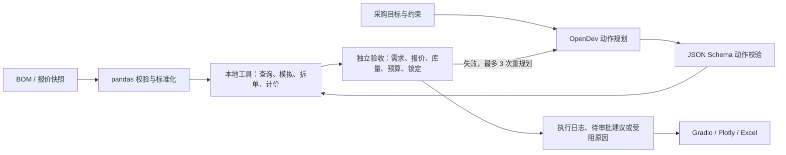

# BOM-BOM队 · BOM Pilot 作品说明

BOM Pilot 是面向 AI 硬件团队的采购决策工作台。它把 BOM、报价阶梯、最小起订量和库存放在同一套可复算的约束下，让团队看清采购方案如何产生、是否能落地、为什么需要调整或停止。

## 功能清单

| 功能 | 状态与验证范围 |
| --- | --- |
| BOM 管理 | 支持 XLSX / CSV，标准化料号和报价，诊断缺失价格、重复料号及无效输入。 |
| 成本分析 | 支持单机、批量、类别构成、主要物料和历史时点重估。金额由 Python Decimal 计算，图表使用 Plotly。 |
| 采购方案 | 在已录入的报价、库存、MOQ 和阶梯内选择供应商，可拆单。独立验收器复算金额并检查需求、预算及锁定约束。 |
| 决策室 | 公开版三个快捷演示通过本地计算流程运行，执行顺序和结果可查。自然语言入口在配置 OpenDev Secret 且用户明确授权发送摘要后启用。OpenDev 自主工具选择曾在历史受控环境真实验证，本次未调用公开版 OpenDev。 |
| 方案对比与交付 | 展示成本、缺口、未满足约束、待审批项。可下载 Excel，含独立建议 BOM。 |
| 部署 | Gradio 工作台由 GitHub Actions 同步到 ModelScope 的 Git 仓库。纯 Python 工具可独立运行。 |

## 系统架构

生产数量与金额以确定性 Python 工具输出为准。模型接收必要的摘要，不能直接修改原始 BOM。模型前端单次任务最多 7 个请求，达到用量阈值即停止追加请求。公开快捷演示走本地工具流程，同样保留工具和验收记录。

## 测试与限制

- 正式源提交在本次重新运行 **86 项 pytest**，全部通过。测试范围包括数据校验、成本复算、拆单与库存、MOQ、预算、重规划上限、Excel 导出和部署同步。
- 复验器从正式样本独立复算历史 OpenDev A/B/C 日志，三个场景均复现原验收结论。历史工作台测试采用 claude-opus-5-5，见证据目录。公开快捷演示与历史 OpenDev 测试的执行来源分别标识。
- 当前输入是单层 BOM 和单币种静态报价快照。精确拆单搜索有规模与数量精度上限。模型工具调用依赖可用凭据和网关，外部市场查询、替代料工程兼容性、交期预测、自动采购和交易均未验证为可用功能。
- 所有演示物料、供应商、价格和库存均为虚构，不作实际采购依据。

本次验证覆盖 ModelScope 公开实例的配置和三个快捷场景，并在正式提交的本地复现实例中通过 Chromium 核对成本图、三案的工具记录、方案对比以及 Excel 下载。
